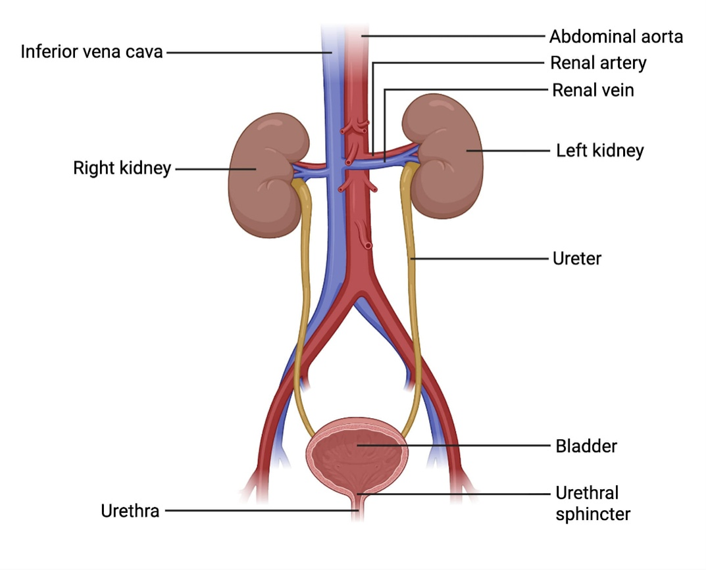
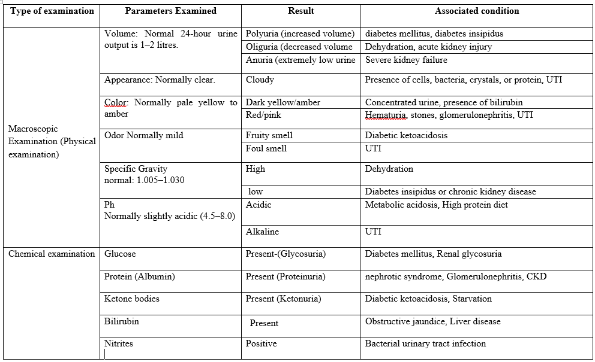
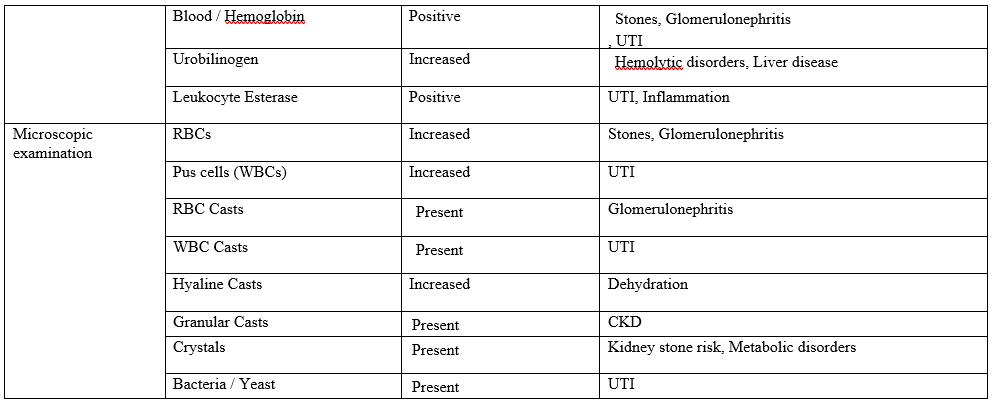

### Theory

Urine analysis, also known as urinalysis, is one of the oldest and most widely used laboratory tests in clinical practice for analysing a urine sample.  Urine is a fluid continuously formed and excreted by the body. In the laboratory, urinalysis test detects the appearance, content, and concentration of a urine sample and is used to screen or diagnose disease conditions such as urinary tract infections, kidney disorders, liver problems, diabetes, and other metabolic conditions. The urinary system includes your kidneys, ureters, bladder and urethra. Kidneys are the two bean-shaped organs positioned below the rib cage and on either side of the spine. They contain tiny filtering units called nephrons (1.3 million) used to filter soluble waste products from the bloodstream, excess water, sugars and a variety of other compounds to produce urine. The urine therefore contains a higher concentration of urea and other toxic products. Ureters are the two thin muscular tubes that push the urine down from the kidneys to the bladder. The bladder is in the lower pelvis and is a hollow, balloon-shaped muscular organ that stores the urine until it is released. The urethra carries the urine from the bladder to the outside of the body (Figure 1). Urinary sphincter muscles are the urethral muscles. The internal sphincter muscles are smooth and involuntary, while the external urethral muscles are voluntary skeletal muscles. These muscles undergo contraction and relaxation during the micturition process. The body takes nutrients from food and converts them to energy. After the body has taken the food components that it needs, waste products are left behind in the bowel and in the blood. The body absorbs nutrients from food and converts them to energy. After absorption, the waste products are left behind in the bowel and in the blood. The urinary system eliminates liquid waste, urea and balances the potassium, sodium, and water levels in the body. Urea is accumulated because of consuming food containing protein. It is carried through the bloodstream to the kidneys and gets removed along with water and other waste in the form of urine. Urination refers to a voluntary process to empty the urinary bladder based on a person's choice and time.  Regulation of the body's water volume, salt concentration (Na+, K+, Ca2+, Mg2+ etc.), maintenance of blood pH, hormone production, and fluid level control to keep blood pressure steady, and secretion of erythropoietin to make red blood cells are the functions of the urinary system. An average healthy adult produces 1.2 to 2 litres of urine per day.

 
  <i>Figure 1: Anatomy of the human urinary system 

(image source  https://microbenotes.com/human-urinary-system/)
</i>

&nbsp;

### Common Diseases and Disorders Associated with the Urinary System

These include diseases and disorders that affect the kidneys, ureters, bladder, and urethra and interfere with urine production, storage, waste removal, and regulation of body fluids.

&nbsp;

**1. Urinary tract infection (UTI):** The infection occurs when bacteria enter the urinary tract through the urethra. The common symptoms of UTI are a burning sensation while urinating, frequent urination, and lower abdominal pain. It can cause hematuria, which means the presence of blood in the urine.

&nbsp;

**2. Kidney Stones:** A kidney stone refers to a solid crystal that forms in the kidney from minerals in the urine. The condition is also known as renal calculus. The major crystal deposits in kidney stones are calcium-ion crystals.  The stones produced pass through the urine stream. The smaller stones pass through the ureters without any symptoms, and larger stones block the ureter and cause pain, decrease kidney function, and cause damage to the kidney. Symptoms include hematuria, severe back or side pain, nausea, and painful urination.

&nbsp;

**3. Chronic Kidney Disease (CKD):** A long-term condition where the kidneys have been damaged over time and lose their ability to filter waste, toxins, and extra fluid from the blood. The common symptoms are foamy urine, nausea, Loss of appetite, and frequent urination. The common risk factors associated with CKD are diabetes, high blood pressure, obesity, family history of kidney diseases, smoking, tobacco, and alcohol use. 

&nbsp;

**4. Diabetic ketoacidosis:** A serious health condition that occurs because of diabetes. The body does not have enough insulin to use glucose for energy production. Instead, the body breaks down fat as a source for energy and produces excess acids called ketones. These ketones build up in the body at a dangerous level. This significantly affects normal kidney function. The common symptoms are excessive thirst, frequent urination, abdominal pain, and weakness and confusion.

&nbsp;

**5. Nephrotic Syndrome:** It is a kidney disorder caused by damage to the tiny blood-filtering units, glomeruli, in the kidneys. This results excessive amounts of proteins to leak from the blood into the urine. Symptoms include foamy urine due to proteinuria (excessive protein), swelling of the feet, ankles, legs, and around the eyes, weight gain, and low albumin levels in the blood. The underlying causes are diabetes mellitus, Autoimmune disorders, and glomerular diseases. and certain medications. Glomerulonephritis refers to a group of kidney diseases characterized by inflammation of the glomeruli. 

&nbsp;

**6. Obstructive Jaundice:** It is caused by the blockage of the bile ducts, which prevents bile from flowing from the liver into the small intestine, resulting in the buildup of conjugated bilirubin in the bloodstream. This occurs due to gallstones, tumors of bile duct inflammation. The common symptoms include yellowing of the skin and eyes, dark urine due to the excretion of excess bilirubin through the kidneys, and abdominal pain.

&nbsp;

**7. Urinary Incontinence:** This occurs due to the lack of bladder control, resulting in involuntary urine leakage during coughing, sneezing, or any physical activity.

&nbsp;

**8. Cystitis (Bladder Inflammation):** It is a bacterial infection of the urinary bladder. The common symptoms are frequent urination, dysuria, and abdominal pain.

&nbsp;

**9. Hydronephrosis:** This condition is the swelling of one or both kidneys as the urine cannot drain properly from the body and accumulates inside due to kidney stones or other UTI's.

&nbsp;

### Urine Dipstick Test

The urine dipstick test (Urine test strips) is a rapid, semi-quantitative, inexpensive diagnostic tool in clinical biochemistry for screening pathological conditions by detecting chemical changes on the small reagent pads (Table 1). It usually checks for glucose, bilirubin, ketones, specific gravity, blood cells, pH, protein, urobilinogen, nitrite, and leukocytes in the urine sample. For this, collect a fresh urine sample in a clean container. Immerse the reagent pads of the strip in the urine sample for a few seconds. Then remove the excess urine with a blotting paper towel, and after the reaction time required for each parameter, compare the color changes on each pad with the standard color chart provided by the manufacturer. In the routine dipstick screening method for proteins, tetramethylbenzidine dye is used, where the dye binds to the protein and shifts its color. The pad changes from yellow to green or blue, indicative of the presence of protein.  In the glucose test, the strip specifically detects D-glucose. This includes immobilized enzymes: glucose oxidase and peroxidase. Glucose oxidase reacts with glucose and oxygen to create a color change. A positive test is indicated by darker green or brown, depending on the strip brand. In the ketone test, instead of sugar the body breaks down fat for energy resulting in the production of ketone bodies: Acetoacetic acid, acetone, and beta-hydroxybutyric acid. The dipstick pad includes sodium nitroprusside and disodium phosphate as an alkaline buffer. Acetoacetic acid reacts with sodium nitroprusside to form a purple-colored complex. Colour change of the pad from light pink to deep purple or maroon indicates a positive test.

Diazo Reaction detects the presence of conjugated bilirubin in urine. The dipstick pad has a diazonium salt stable under an acidic medium. In the acidic condition, the diazonium salt is active and will not interfere with urine pigments. During the coupling reaction, the conjugated bilirubin reacts with diazonium salt to form azobilirubin, a pink to violet colored complex. A positive bilirubin test is indicated by the pad colour change from A positive test changes through light pink to deep purple or violet. The doctor may prescribe a concentrated first morning void urine sample for better results.

Urine sediment analysis is the microscopic examination of urine where a centrifuged urine sample is inspected under a microscope to identify and count cells, casts, crystals, and microorganisms. One drop of concentrated sediment is placed on a glass slide under a coverslip and observed under low power and high power to count cells and microorganisms. The cellular components such as RBCs, WBCs, and epithelial cells are reported per high-power field (HPF). Normal urine contains 0 to 2 RBCs/HPF, 0-5 WBC's/HPF. A higher number indicates infection or any other underlying disease. The urinary casts, cylindrical molds inside the kidney tubules are reported per low-power field (LPF). Hyaline Casts are protein molds due to dehydration or fever; cellular casts are either RBCs or WBCs, formed due to kidney infection; and Granular and Waxy Casts are degenerating cellular debris due to CKD. 

&nbsp;

  <i>Table 1. Urine analysis in a clinical laboratory and associated disease conditions 
</i>

 

</i>

&nbsp;
